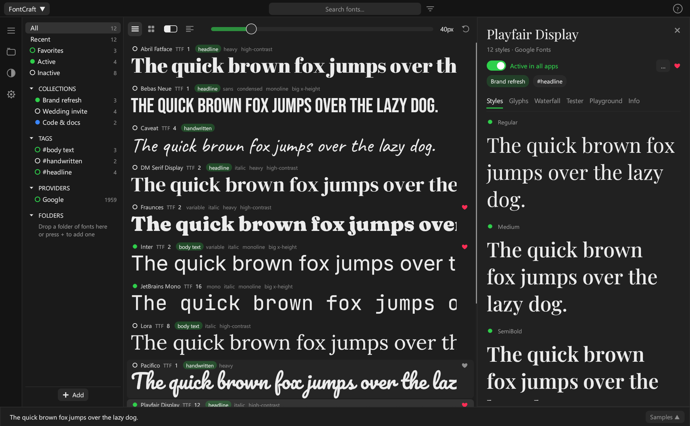
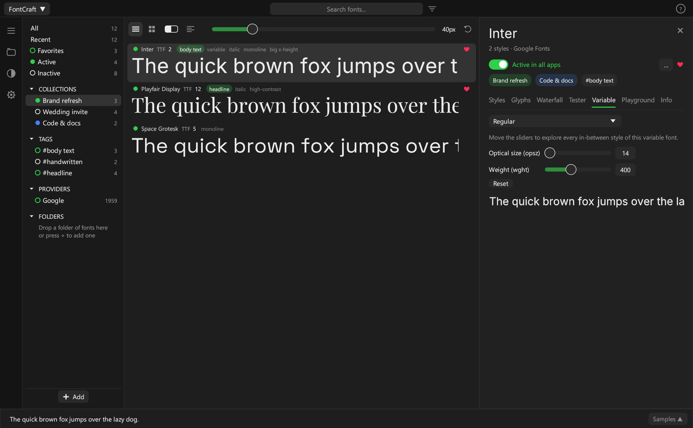
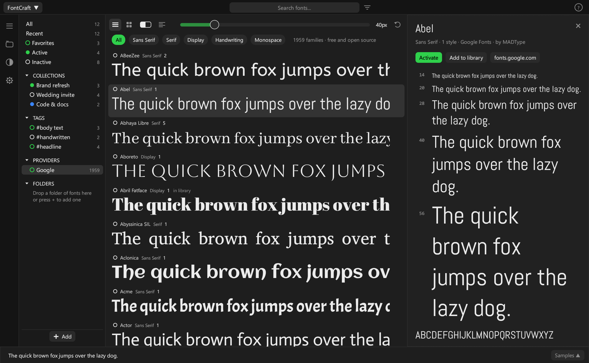
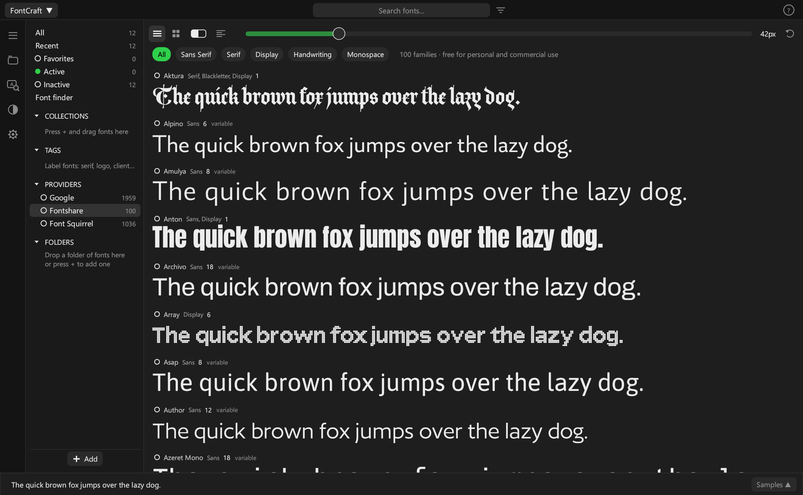
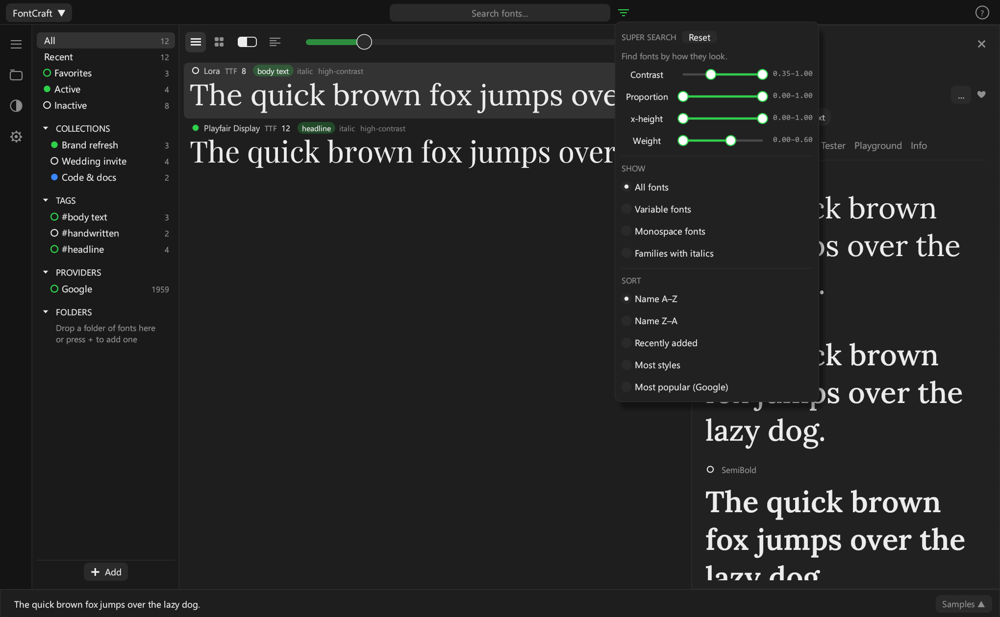
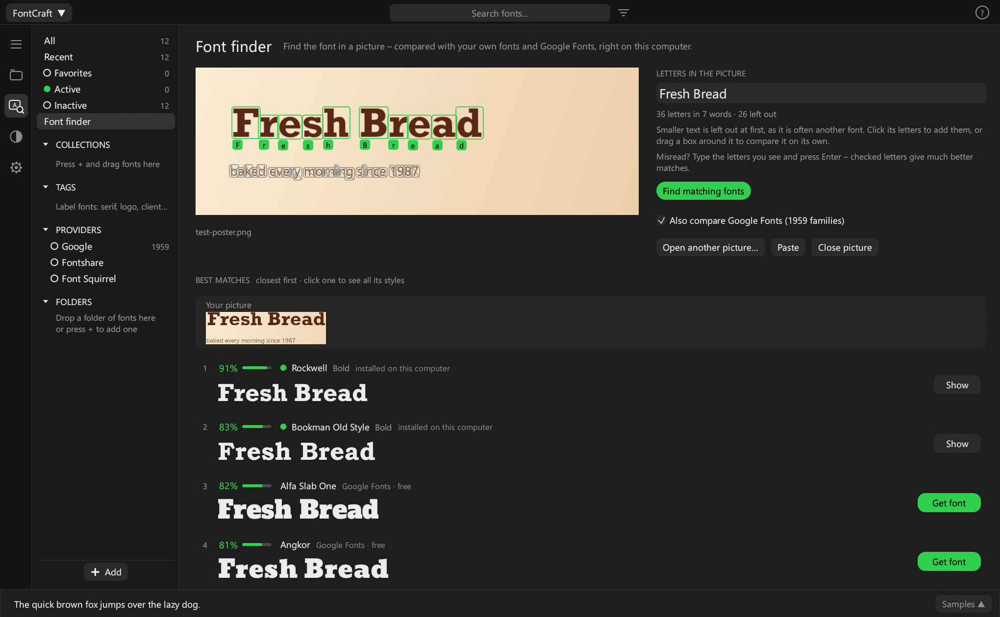
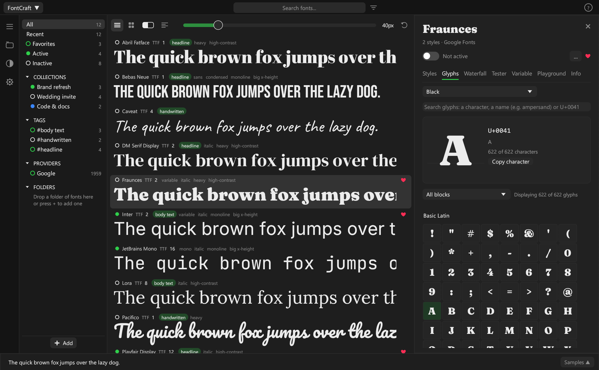
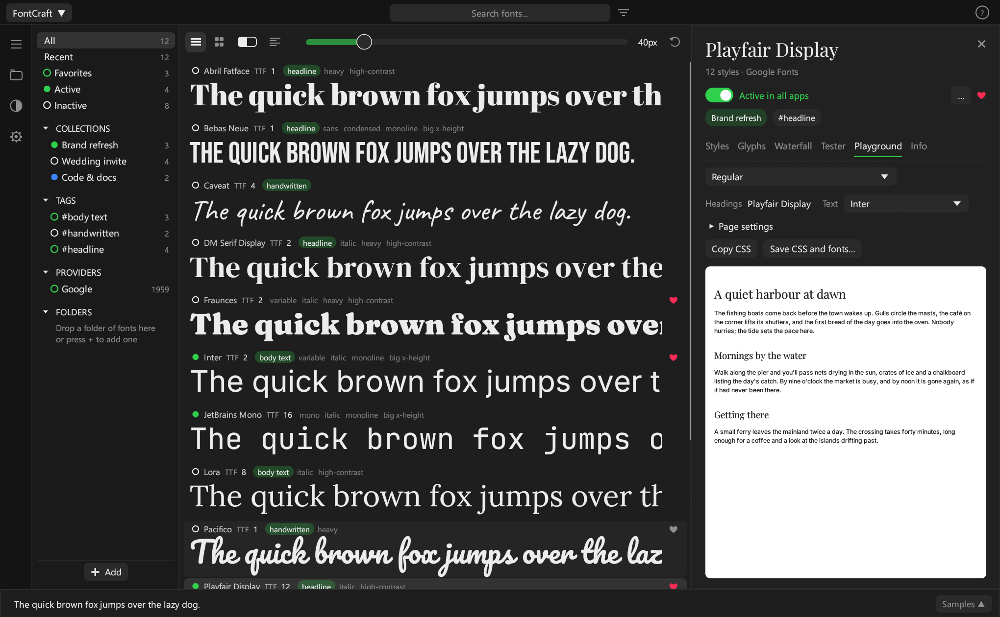
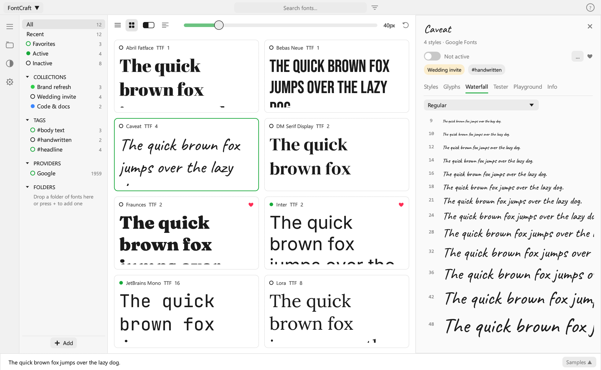

# FontCraft

A free font manager for **Windows, macOS and Linux**. Keep the fonts you own in your own folders,
preview them, sort them into collections, and switch them on only when you need them. Active fonts show up
in Word, Photoshop, Affinity and every other app, so you don't have to install your whole font collection
on the system.

Every feature is included for everyone. There's no account, no subscription and no ads.



## Download

Get the newest version from the **[Releases page](../../releases/latest)**:

| Your computer | File |
|---|---|
| Windows 10 / 11 | `FontCraft-Windows-x64.exe` (or the `.zip`) |
| Mac with Apple chip (M1 and newer) | `FontCraft-macOS-AppleSilicon.zip` |
| Mac with Intel chip | `FontCraft-macOS-Intel.zip` |
| Linux | `FontCraft-Linux-x64.tar.gz` |

* **Mac:** unzip the file and move FontCraft to Applications. The first time, right-click it and choose *Open*.
* **Windows:** if SmartScreen warns about an unknown app, click *More info* › *Run anyway*.
* **Linux:** unpack the file and run `./install.sh` to add FontCraft to your app menu.

FontCraft tells you when a newer version is out. You can turn this off in Settings.

FontCraft doesn't include any font files. It shows the fonts already on your computer, the folders you add,
and the free fonts you choose to download from Google Fonts, Fontshare or Font Squirrel.

## What it can do

### Your library, switched on and off with one click
Add any folders with fonts; sub-folders appear as a tree. FontCraft watches them, so fonts you copy in show up
within seconds and deleted ones disappear. Click the dot next to a font, folder, collection or tag to activate it.
A filled dot means the font can be used in every app.

### Network folders
Add a shared folder from a server, a NAS or another computer (*Add › Add network folder…*): `\\server\fonts`, a
mapped drive, or `smb://server/fonts` on macOS and Linux. Its fonts are switched on like any others. When the
network is away, FontCraft remembers which of them were active and switches them on again when it's back.

### Deleting fonts
Right-click a font › *Delete…* (or select several and press Delete). FontCraft always asks first:

* **Online fonts** are deactivated and their local copy is deleted; activating them again downloads them again.
* **Fonts in your folders** are deleted for good (not to the Recycle Bin or Trash), so FontCraft asks if you're sure.
* **System fonts** can be **moved** into one of your FontCraft folders instead of being deleted. Fonts the system
  needs itself are marked and left out by default, and FontCraft explains the risks on Windows, macOS and Linux.
  Your system asks for administrator permission where needed.

### Collections and tags
Drag fonts onto a collection or tag in the sidebar. Collections can be exported to a folder, printed as a specimen
and exported as CSS. FontCraft also adds tags by itself (serif, sans, script, mono, heavy, condensed, high-contrast…).



### Google Fonts
Browse about 1,900 free families with live previews and filter them by category. Click the dot to download and
activate a family.



### Fontshare and Font Squirrel
Two more free sources sit next to Google under *Providers*:

* **Fontshare** – about 100 high-quality families from the Indian Type Foundry, free for personal and commercial
  use. Live previews, filters and one-click download and activation, just like Google Fonts.
* **Font Squirrel** – about 1,000 hand-picked families that are free for commercial use. Font Squirrel only hands
  its files to a web browser, so clicking the dot opens the download in your browser; FontCraft notices the file in
  your Downloads folder, adds the family and activates it. Previews appear once a family is in your library.



Adobe Fonts is not included: its fonts can only be switched on through Adobe's own Creative Cloud app.

### Super search
Find fonts by how they look: contrast, proportion, x-height and weight, measured from the letters themselves.



### Font finder: which font is in this picture?
Drop, open or paste (Ctrl+V) a picture with text: a screenshot, a photo of a poster, a logo. FontCraft finds the
letters, reads them, and compares their shapes with **every font in your library, on your computer and on Google
Fonts**, closest first. Activate a match with one click, or get a Google family straight into your library.

* Drag a box around the text you care about; click a letter to leave it out.
* Fix misread letters by typing the text you see. Joined-up script works best this way, because whole words are then compared.
* Everything happens on your computer and the picture is never uploaded. For Google Fonts, FontCraft fetches just the
  letters of each family once (a few KB each), then it works offline.
* You can also open a picture with FontCraft ("Open with…"), or start it with `--finder`.



### Every glyph
See every character, grouped by Unicode block, with search. Double-click a glyph to copy it. A right-click
copies its code or HTML entity.



### Playground
Try a font on a sample page, with a second font for the body text. Tune sizes, line height and width, then copy
the CSS or save it together with the font files.



### Grid view, waterfall and themes
A compact grid, a waterfall of sizes, a type tester, sliders for variable fonts, and six colour themes
(Classic, Dark, Sand, Light, Midnight, Sepia).



### And also
* **Auto-activation:** drop a Photoshop, Illustrator, InDesign, PDF, SVG, Word or PowerPoint file onto the window,
  or watch project folders. The fonts the document uses are switched on, and missing ones can come from Google Fonts.
* **Sync:** keep collections, tags and favorites (and the fonts in your collections) in step across computers
  through Dropbox, Google Drive, OneDrive or iCloud Drive.
* **Search:** type several words to match names, styles, designers, foundries and tags. The × clears the search.
* **Autostart** when you sign in (Windows, macOS, Linux), and **hide to the system tray** when closing (Windows only).
* Group styles into families your own way (right-click › *Change family name…*).

## How activation works

| System | What FontCraft does |
|---|---|
| Windows | registers the font file for your current session (no admin rights, nothing copied) |
| macOS | places a link to the file in your user's `Library/Fonts` |
| Linux | places a link in `~/.local/share/fonts/FontCraft` and refreshes the font cache |

Some apps (for example older Adobe versions) only see newly activated fonts after you restart them.

## Building from source

Install [Rust](https://rustup.rs), then:

```sh
cargo build --release
```

On Linux you also need the usual window libraries, for example
`sudo apt install libxkbcommon-dev libwayland-dev libgl1-mesa-dev libxcb-render0-dev libxcb-shape0-dev libxcb-xfixes0-dev`.

Releases are built automatically by GitHub Actions (`.github/workflows/release.yml`).
See [PUBLISHING.md](PUBLISHING.md) for how to make a new release.

The screenshots show free fonts from Google Fonts and Fontshare. What changed in each version is in
[CHANGELOG.md](CHANGELOG.md).

## License

MIT. See [LICENSE](LICENSE).
